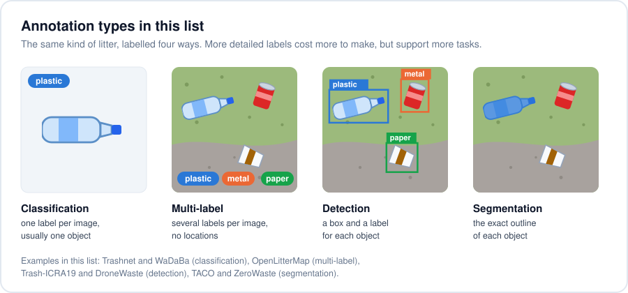
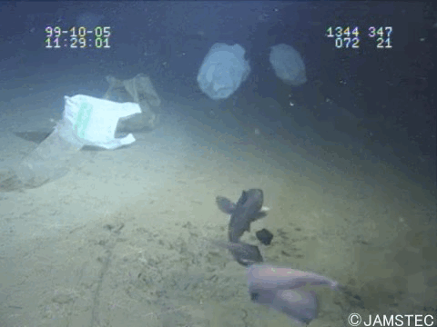
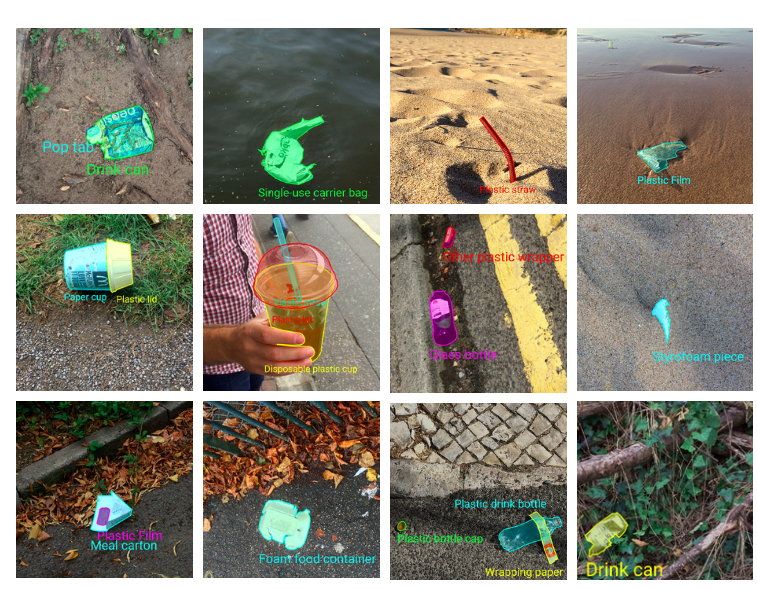
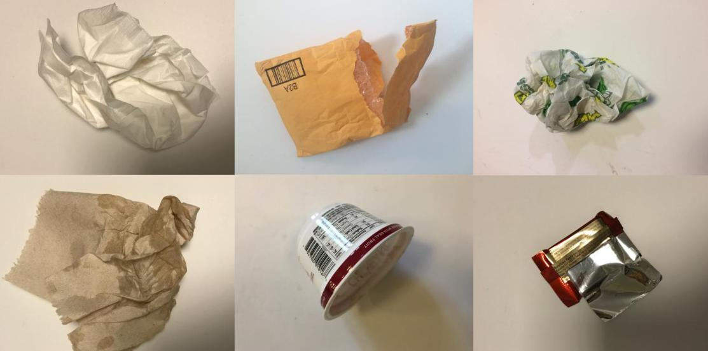
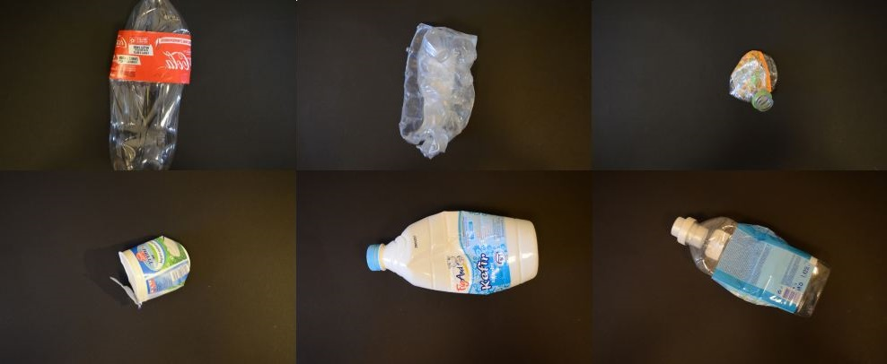
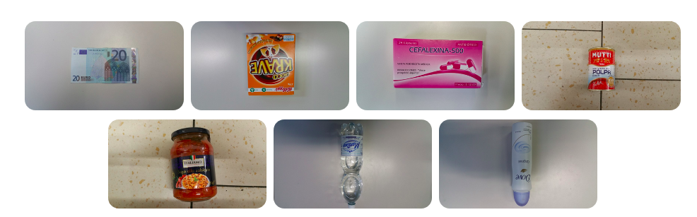
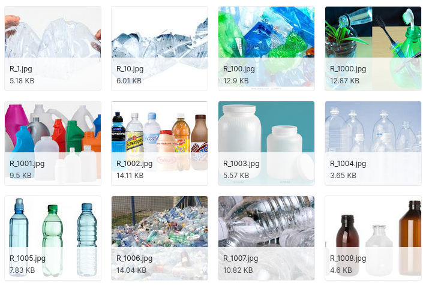
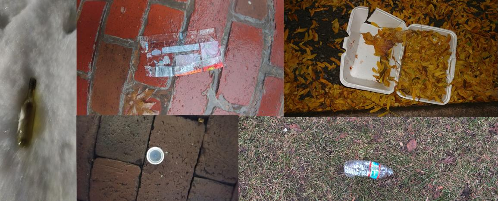
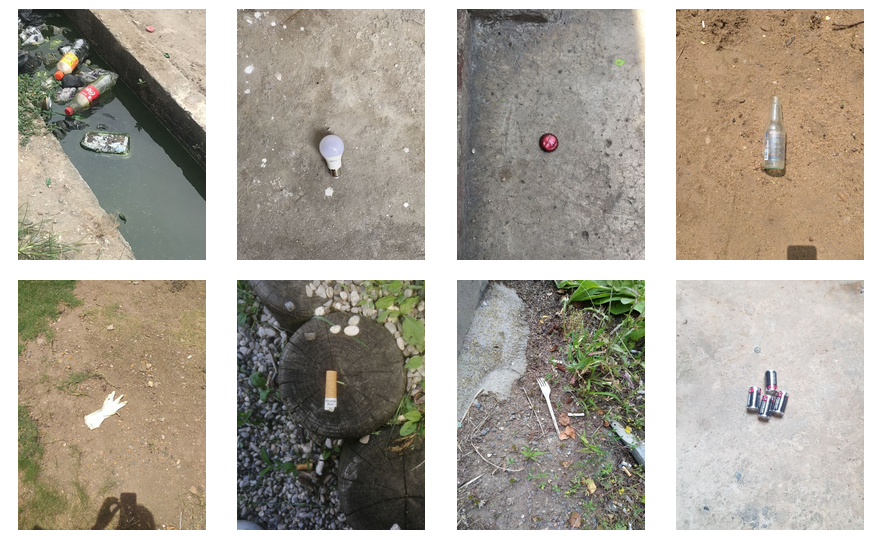
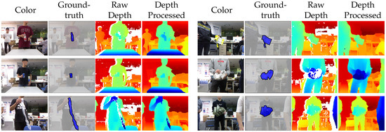

# Waste datasets review

List of datasets with any kind of litter, garbage, waste and trash. Created during the [Detect Waste](https://github.com/wimlds-trojmiasto/detect-waste) project

Today, more than 300 million tons of plastic are produced annually. Plastic is everywhere and we constantly use it in our daily life.

The idea of **detect waste project** is to use Artificial Intelligence to detect plastic waste in the environment. Our solution will be applicable for video and photography. Our goal is to use AI for Good.

**Visit [majsylw/litter-detection-review](https://github.com/majsylw/litter-detection-review) to see broader review of papers, projects and other resources concerning the problem of litter in an environment.**

> **November 2026 update:** 16 new datasets (rivers, underwater, drone, recycling plants, e-waste and medical waste), broken and moved links fixed, an annotation types figure, and a table of datasets by setting.

## Choosing a dataset

The datasets differ in where the images were taken and how they are labeled. Classification datasets only say what is in an image; detection and segmentation datasets also say where each object is.

This table groups the datasets by where the images were taken and by the most detailed annotation each one has. SWIR hyperspectral waste cubes are not included (no labels).

| Setting | Classification | Detection | Segmentation |
|---|---|---|---|
| **Plain background (single objects)** | [Trashnet](#trashnet), [WaDaBa](#plastic-waste-database-of-images--wadaba), [GLASSENSE-VISION](#glassense-vision), Sushi Restaurant, TIDY, [Garbage Dataset V2](#garbage-dataset-v2), [Medical-Waste-4.0](#medical-waste-40), [ETID-v2](#etid-v2-e-tadweer-image-dataset) | [Drinking Waste](#drinking-waste-classification), PortlandStateSingh | [MJU-Waste](#mju-waste-v10) |
| **Web images (scraped)** | [Waste Classification data](#waste-classification-data), [Waste Classification v2](#waste-classification-data-v2), [waste_pictures](#waste_pictures), [spotgarbage](#spotgarbage---gini-dataset) | [TrashBox](#trashbox-dataset) | – |
| **Streets and outdoors** | [Open Litter Map](#open-litter-map) | [TACO bboxes](#taco-bboxes), [Litter](#litter), [Domestic Trash](#domestic-trash-dataset), [Cigarette butts](#cigarette-butt-dataset), [PlastOPol](#plastopol), [pLitterStreet](#plitterstreet), [RoLID-11K](#rolid-11k), [SWiM3](#swim3) | [TACO](#taco) |
| **Beaches** | – | – | [BePLi v1](#bepli-dataset-v1), [BePLi v2](#bepli-dataset-v2), [BeachLitter](#beachlitter-dataset-v2022) |
| **Underwater (camera and sonar)** | [DeepSeaWaste](#deepseawaste) | [Trash-ICRA19](#trash-icra19), [DeepPlastic](#deepplastic) | [TrashCan 1.0](#trashcan-10), [Seaclear](#seaclear-marine-debris), [Marine Debris FLS](#marine-debris-fls) |
| **Rivers and lakes (floating litter)** | [TUD-GV](#tud-gv) | [IWHR Floater](#iwhr_ai_lable_floater_v1), [FloW](#flow-flow-img--flow-ri), [FloatWaste](#floatwaste) | [RiSID](#risid-river-surface-image-dataset), [AquaPlasticWaste](#aquaplasticwaste-2026) |
| **Drone and satellite** | [AerialWaste](#aerialwaste) | [DroneWaste](#dronewaste) | [UAVVaste](#uavvaste), [MARIDA](#marida-marine-debris-archive), [MADOS](#mados-marine-debris-and-oil-spill) |
| **Recycling plants and landfills** | [RealWaste](#realwaste) | [WaRP](#warp-waste-recycling-plant) | [ZeroWaste](#zerowaste), [SpectralWaste](#spectralwaste), [CODD](#codd-construction-and-demolition-waste-object-detection-dataset) |

The [summary table](#summary) lists every dataset with its size, annotation type and license. Click a name to jump to its description.

## Contributing

Feel free to add **issue** with short description of new dataset or create a **pull request** - add the new dataset to the table or fill missing description.

# Summary

| Name                               	| No. categories 	| No. subcategories              	| No. images 	| Annotation                	| Comment                              	| Website                                                             	| License | Description        	|
|------------------------------------	|----------------	|--------------------------------	|------------	|---------------------------	|--------------------------------------	|---------------------------------------------------------------------	|-------- | --------------------	|
| [TrashCan 1.0](#trashcan-10) | 3              	| 34                             	| 7 212      	| Instance-Segmentation     	| Underwater images                    	| [website](https://conservancy.umn.edu/handle/11299/214865)                     	| Free for academic teaching/research use, must obtain JAMSTEC permission for commercial use.  | :heavy_check_mark: 	|
| [Trash-ICRA19](#trash-icra19) | 3              	| 34                             	| 5 700      	| Detection                 	| Underwater images                    	| [website](https://conservancy.umn.edu/handle/11299/214366)                     	| Free for academic teaching/research use, must obtain JAMSTEC permission for commercial use.  | :heavy_check_mark: 	|
| [TACO](#taco) | 28             	| 60                             	| 1 500      	| Segmentation              	| Waste in the wild                    	| [website](http://tacodataset.org/stats)                                        	| MIT license | :heavy_check_mark: 	|
| [TACO bboxes](#taco-bboxes) | 7              	| 60                             	| WIP        	| Detection                 	| Waste in the wild                    	| WIP                                                                 	| ? | :heavy_check_mark: 	|
| [UAVVaste](#uavvaste) | 1              	| -                              	| 772        	| Segmentation              	| Drone dataset                        	| [github](https://github.com/PUTvision/UAVVaste)                                	| Apache license | :heavy_check_mark: 	|
| [Trashnet](#trashnet) | 6              	| -                              	| 2 527      	| Classification            	| Clear background                     	| [github](https://github.com/garythung/trashnet)                               	| MIT license | :heavy_check_mark: 	|
| [WaDaBa](#plastic-waste-database-of-images--wadaba) | 8              	| color,size, shape, or material 	| 4 000      	| Classification            	| Plastic dataset, clear background    	| [website](http://wadaba.pcz.pl/)                                               	| ? | :heavy_check_mark: 	|
| [GLASSENSE-VISION](#glassense-vision) | 7              	| 136                            	| 2 000      	| Classification            	| Home-supplies, clear background      	| [archived website](http://web.archive.org/web/20210925062127/http://www.slipguru.unige.it/Data/glassense_vision/)                 	| ? | :heavy_check_mark: 	|
| [Waste Classification data](#waste-classification-data) | 2              	| -                              	| ~25 000    	| Classification            	| Scraped from google search           	| [kaggle](https://www.kaggle.com/techsash/waste-classification-data)           	| CC BY-SA 4.0 | :heavy_check_mark: 	|
| [Waste Classification Data v2](#waste-classification-data-v2) | 3              	| -                              	| ~27 500    	| Classification            	| Scraped from google search           	| [kaggle](https://www.kaggle.com/sapal6/waste-classification-data-v2)          	| CC BY-SA 4.0 | :heavy_check_mark: 	|
| Waste Images from Sushi Restaurant 	| 16             	| -                              	| 500        	| Classification            	| Clear background                     	| [kaggle](https://www.kaggle.com/arthurcen/waste-images-from-sushi-restaurant) 	| Database: Open Database, Contents: © Original Authors |  	|
| [Open litter map](#open-litter-map) | 11             	| 187                            	| > 100k     	| Multilabel classification 	| Waste in the wild                    	| [website](https://openlittermap.com/)                                          	| ? | :heavy_check_mark: 	|
| [Litter](#litter) | 24             	| size, shape, or material       	| ~14 000    	| Detection                 	| Waste in the wild, paid license      	| no longer online                       	| ? | :heavy_check_mark: 	|
| [Drinking Waste Classification](#drinking-waste-classification) | 4              	| -                              	| 9640       	| Detection                 	| Clear background, (cans and bottles) 	| [kaggle](https://www.kaggle.com/arkadiyhacks/drinking-waste-classification)   	| CC0: Public Domain | :heavy_check_mark: 	|
| [waste_pictures](#waste_pictures) | 34             	| -                              	| ~24 000    	| Classification            	| Scraped from google search           	| [kaggle](https://www.kaggle.com/wangziang/waste-pictures)                     	| Unknown | :heavy_check_mark: 	|
| [spotgarbage](#spotgarbage---gini-dataset) | 3              	| -                              	| ~2 400     	| Classification            	| Scraped from Bing search           	| [kaggle](https://www.kaggle.com/apremeyan/garbage)  [github](https://github.com/spotgarbage/spotgarbage-GINI)                            	| CC0: Public Domain | :heavy_check_mark: 	|
| [DeepSeaWaste](#deepseawaste) | 5              	| -                              	| 3 055      	| Classification            	| Underwater images                    	| [kaggle](https://www.kaggle.com/henryhaefliger/deepseawaste)                  	| Unknown | :heavy_check_mark: 	|
| [MJU-Waste v1.0](#mju-waste-v10) | 1              	| -                              	| 2475      	| Segmentation            	  | Plain background, indoor RGBD images                    	| [github](https://github.com/realwecan/mju-waste/)                  	| MIT license | :heavy_check_mark: 	|
| [Domestic Trash Dataset](#domestic-trash-dataset) | 10              | -                              	| > 9000      | Classification/Detection    | Waste in the wild, paid license, 250 images for free                    	|  [github](https://github.com/datacluster-labs/Domestic-Trash-Dataset)                 	| ? | :heavy_check_mark: 	|
| [Cigarette butt dataset](#cigarette-butt-dataset) | 1              	| -                              	| 2200      	| Detection            	      | Waste in the wild, synthetic images                    	|  [website](https://www.immersivelimit.com/datasets/cigarette-butts)                 	| Non-Commercial, Educational License Agreement | :heavy_check_mark: 	|
| [TrashBox](#trashbox-dataset) | 7 | 25 | 17785 | Classification/Detection | Scraped from web | [github](https://github.com/nikhilvenkatkumsetty/TrashBox) | ? | :heavy_check_mark: |
| PortlandStateSingh | 5 | - | 11500 | Classification/Detection | Original photos | [website](https://web.cecs.pdx.edu/~singh/rcyc-web/index.html) | ? | |
| TIDY | 9 | - | 304 | Classification | Original photos | [github](https://github.com/gale31/TIDY) | MIT license | |
| [Garbage Dataset (V2)](#garbage-dataset-v2) | 10 | - | 19 762 | Classification | Household waste. Used in paper "Managing Household Waste Through Transfer Learning" | [kaggle](https://www.kaggle.com/datasets/sumn2u/garbage-classification-v2) | MIT license | :heavy_check_mark: |
| [RealWaste](#realwaste) | 9 | - | 4 752 | Classification | Collected in authentic landfill environment. 524x524 resolution. | [UCI ML Repo](https://archive.ics.uci.edu/dataset/908/realwaste) | ? | :heavy_check_mark: |
| [BePLi Dataset v1](#bepli-dataset-v1) | 1 | - | 3 709 | Instance Segmentation / Object Detection | Beach plastic litter (various types) in coastal environments (Japan). MS COCO format. | [ResearchGate Paper](https://www.researchgate.net/publication/370218660_BePLi_Dataset_v1_Beach_Plastic_Litter_Dataset_version_1_for_instance_segmentation_of_beach_plastic_litter) | CC BY 4.0 | :heavy_check_mark: |
| [ZeroWaste](#zerowaste) | 4 | - | 4 503 (+ 6 212 unlabeled, + 1 410 weakly) | Instance-Segmentation / Detection | Recycling plant conveyor belts | [github](https://github.com/dbash/zerowaste) | CC BY-NC 4.0 (dataset) | :heavy_check_mark: |
| [BeachLitter dataset v2022](#beachlitter-dataset-v2022) | 8 | - | 3 500 | Segmentation | Beach litter (8 classes) | [doi](https://doi.org/10.17882/85472) | CC BY 4.0 | :heavy_check_mark: |
| [BePLi Dataset v2](#bepli-dataset-v2) | 13 | - | 3 722 | Instance Segmentation / Object Detection | Beach plastic litter (Japan). Update of BePLi. | [doi](https://doi.org/10.17882/96963) | CC BY-NC-SA 4.0 | :heavy_check_mark: |
| [MARIDA](#marida-marine-debris-archive) | 15 | confidence level (3) | 1 381 patches | Weakly-supervised semantic segmentation | Sentinel-2 remote sensing (marine debris) | [zenodo](https://zenodo.org/records/5151941) | CC BY 4.0 | :heavy_check_mark: |
| [MADOS](#mados-marine-debris-and-oil-spill) | 15 | confidence level (3) | 2 803 patch crops | Semantic segmentation (sparse) | Sentinel-2 remote sensing (marine debris + oil spill) | [zenodo](https://zenodo.org/records/10664073) | Open (see Zenodo) | :heavy_check_mark: |
| [DroneWaste](#dronewaste) | 20 | - | 4 993 | Detection | Drone orthomosaics (illegal dumpsites) | [zenodo](https://zenodo.org/records/17288038) | CC BY 4.0 | :heavy_check_mark: |
| [SpectralWaste](#spectralwaste) | 6 | - | 852 | Instance Segmentation / Classification | Waste sorting; RGB + SWIR hyperspectral | [zenodo](https://zenodo.org/records/10880544) | CC BY 4.0 | :heavy_check_mark: |
| [SWIR hyperspectral waste cubes](#swir-hyperspectral-waste-cubes) | - | - | 7 cubes | - | SWIR hyperspectral (980–2500 nm) waste objects | [mendeley](https://data.mendeley.com/datasets/dpnrxcc8fv/2) | CC BY 4.0 | :heavy_check_mark: |
| [IWHR_AI_Lable_Floater_V1](#iwhr_ai_lable_floater_v1) | ? | - | 3 000 | Detection | Floating debris in inland waters (shore-based) | [paper](https://doi.org/10.1038/s41597-025-04594-9) [figshare](https://doi.org/10.6084/m9.figshare.27376851.v1) | ? | :heavy_check_mark: |
| [FloW (FloW-Img / FloW-RI)](#flow-flow-img--flow-ri) | ? | - | 2 000 images (+ 4 000 frames w/ radar) | Detection + radar | Floating waste in inland waters (application needed) | [github](https://github.com/ORCAUBOAT/FloW-Dataset) | Application required | :heavy_check_mark: |
| [Seaclear Marine Debris](#seaclear-marine-debris) | 40 | - | 8 610 | Detection / Instance segmentation (COCO) | Underwater, shallow water (ROV), Croatia and France; also animals, plants and robot parts | [4TU](https://doi.org/10.4121/4f1dff25-e157-4399-a5d4-478055461689) [paper](https://doi.org/10.1038/s41597-024-03759-2) | ? | :heavy_check_mark: |
| [DeepPlastic](#deepplastic) | ? | - | 3 174 | Detection | Underwater plastic in the upper ocean layer (California, JAMSTEC J-EDI) | [zenodo](https://zenodo.org/record/5562940) [paper](https://arxiv.org/abs/2105.01882) | CC BY 4.0 | :heavy_check_mark: |
| [Marine Debris FLS](#marine-debris-fls) | 11 (+ background) | - | 1 868 (water tank segmentation) | Segmentation / Classification / Matching | Forward-looking sonar (water tank, turntable) | [github](https://github.com/mvaldenegro/marine-debris-fls-datasets) [paper](https://arxiv.org/abs/2108.06800) | ? | :heavy_check_mark: |
| [RiSID](#risid-river-surface-image-dataset) | 7 (also 5- and 2-class versions) | - | 7 356 | Instance segmentation (COCO) | Floating macroplastic, 7 rivers in Japan, high flow | [zenodo](https://zenodo.org/records/16927238) [paper](https://doi.org/10.3389/feart.2024.1427132) | CC BY 4.0 | :heavy_check_mark: |
| [FloatWaste](#floatwaste) | 25 | - | 7 906 | Detection (COCO) | Floating river waste, Australia and Indonesia, trail cameras | [huggingface](https://huggingface.co/datasets/OliviaWuYJ/sc-floatwaste) [zenodo](https://doi.org/10.5281/zenodo.21934286) | CC BY 4.0 | :heavy_check_mark: |
| [TUD-GV](#tud-gv) | 4 (litter-count levels) | - | 9 473 | Classification | Floating litter in a drainage canal (TU Delft) | [zenodo](https://zenodo.org/records/7636124) [paper](https://doi.org/10.3389/frwa.2023.1298465) | CC BY 4.0 | :heavy_check_mark: |
| [AquaPlasticWaste 2026](#aquaplasticwaste-2026) | 7 (or binary) | - | 5 000 | Instance segmentation (polygons, COCO/YOLO) | Drone images of floating plastic, Dal Lake (Kashmir) | [mendeley](https://data.mendeley.com/datasets/zshjxgfmc3/1) | CC BY 4.0 | :heavy_check_mark: |
| [AerialWaste](#aerialwaste) | multi-label subset | - | > 11 700 (v3) | Classification / Multi-label / Weak segmentation | Aerial and satellite images of illegal landfills (Lombardy, Italy) | [zenodo](https://zenodo.org/records/12607190) [paper](https://doi.org/10.1038/s41597-023-01976-9) | CC BY-NC-ND 4.0 (v3) | :heavy_check_mark: |
| [PlastOPol](#plastopol) | 1 | - | 2 418 | Detection | Litter in the wild (water, snow, sand, streets) | [zenodo](https://zenodo.org/records/5829156) [paper](https://doi.org/10.3390/s22020548) | CC BY 4.0 | :heavy_check_mark: |
| [pLitterStreet](#plitterstreet) | ? | - | > 13 000 | Detection (COCO) | Street and roadside litter, Thailand, Vietnam and Sri Lanka | [zenodo](https://doi.org/10.5281/zenodo.8288500) [github](https://github.com/gicait/pLitter) | CC BY 4.0 | :heavy_check_mark: |
| [RoLID-11K](#rolid-11k) | 1 | - | 11 565 | Detection | Roadside litter from dashcam video (UK) | [github](https://github.com/xq141839/RoLID-11K) [paper](https://arxiv.org/abs/2601.00398) | Apache 2.0 (repository) | :heavy_check_mark: |
| [SWiM3](#swim3) | 3 | 10 | 6 429 | Detection | Households, parks and public spaces (smartphone photos) | [github](https://github.com/Burhan-Ahmed/SWiM3-Dataset) [paper](https://doi.org/10.1109/ICoDT269104.2025.11360732) | Research and educational use | :heavy_check_mark: |
| [WaRP](#warp-waste-recycling-plant) | 28 | - | 2 974 (detection) + 10 406 crops (classification) + 112 (segmentation) | Detection / Classification / Weak segmentation | Recycling plant conveyor belt | [github](https://github.com/AIRI-Institute/WaRP) [kaggle](https://www.kaggle.com/datasets/parohod/warp-waste-recycling-plant-dataset) | ? | :heavy_check_mark: |
| [CODD](#codd-construction-and-demolition-waste-object-detection-dataset) | 10 | - | 3 129 | Detection / Instance segmentation (VOC) | Construction and demolition waste, recycling facility (Cyprus) | [mendeley](https://data.mendeley.com/datasets/wds85kt64j/3) [paper](https://doi.org/10.1016/j.wasman.2024.02.017) | CC BY 4.0 | :heavy_check_mark: |
| [Medical-Waste-4.0](#medical-waste-40) | 13 | - | ? | Classification | Medical waste, RGB and stereo pair (OAK-D camera) | [zenodo](https://zenodo.org/record/7709001) [paper](https://arxiv.org/abs/2303.04720) | Other (open) | :heavy_check_mark: |
| [ETID-v2 (E-Tadweer)](#etid-v2-e-tadweer-image-dataset) | 23 | - | 14 055 | Classification | E-waste (devices, components, batteries) | [mendeley](https://data.mendeley.com/datasets/bndsgcspbx) | CC BY 4.0 | :heavy_check_mark: |

# Description

## TrashCan 1.0

An Instance-Segmentation Labeled Dataset of Trash Observations

7212 images under 3 main categories: bio, trash, unknown.
Categories:
* bio = turtle, squid, lobster, unknown, jellyfish, stingray, shrimp, crawfish, octopus, shark, shell, crab, starfish, eel
* trash = clothing, pipe, bottle, bag, snack_wrapper, glove, tire, can, cup,container, branch, wreckage, tarp, box, hose, rope, hay, net, paper, bucket, wire
* unknown
**Download**: Directly from website  https://conservancy.umn.edu/handle/11299/214865

## Trash-ICRA19
A Bounding Box Labeled Dataset of Underwater Trash
5,700 underwater images extracted from video
http://jungseokhong.com/

**Download**: Directly from website https://conservancy.umn.edu/handle/11299/214366

## TACO
Open dataset with 1500 images from 28 categories and 60 detailed sub-categories of waste in the wild. Annotations available in COCO-json.

**Download**: Directly from website http://tacodataset.org/

## TACO bboxes
Additional hand-labelled annotations for images from TACO dataset.  There are seven recognized waste categories:
* bio: food waste such as fruit, vegetables, herbs, used paper towels and
tissues,
* glass: glass objects such as glass bottles, jars, cosmetics packaging,
* metals and plastic: scrap metal and non-ferrous metal, beverage cans,
plastic beverage bottles, plastic shards, plastic food packaging, or
plastic straws,
* non-recyclable: residual rubbish such as disposable diapers, pieces of
string, polystyrene packaging, polystyrene elements, blankets,
clothing, or used paper cups,
* other: construction and demolition, large-size waste (e.g. tires), used
electronics and household appliances, batteries, paint and varnish
cans, or expired medicines,
* paper: paper, cardboard packaging, receipts, newspapers, catalogues,
and books,
* unknown waste: (highly decomposed and hard-to-recognize litter),
* and extra class background label without any litter: a sidewalk, a
forest path, a lawn

Read more about it in the paper [Deep learning-based waste detection in natural and urban environments,](https://www.sciencedirect.com/science/article/pii/S0956053X21006474?dgcid=coauthor#fn1).

**Download**: Directly from [detect waste repository](https://github.com/wimlds-trojmiasto/detect-waste/tree/main/annotations)

## UAVVaste
**Drone rubbish detection intelligent technology**
The UAVVaste dataset consists to date of 772 images and 3716 annotations. The main motivation for creation of the dataset was the lack of domain-specific data. The datasets that are widely used for object detection evaluation benchmarking. The dataset is made publicly available and is intended to be expanded.

Available annotations for Detection and Segmentation https://github.com/PUTvision/UAVVaste

**Download**: Directly from annotations json on github https://github.com/PUTvision/UAVVaste

## Trashnet
The dataset spans six classes: glass, paper, cardboard, plastic, metal, and trash. Currently, the dataset consists of 2527 images:

* 501 glass
* 594 paper
* 403 cardboard
* 482 plastic
* 410 metal
* 137 trash

**Download**: Directly from github https://github.com/garythung/trashnet

also is known as **Garbage Classification Data**

The Garbage Classification Dataset contains 2467 images from 6 categories: cardboard (393), glass (491), metal (400), paper(584), plastic (472) and trash(127).

**Download**: Directly from kaggle https://www.kaggle.com/asdasdasasdas/garbage-classification

## Plastic Waste DataBase of Images – WaDaBa
4000 images with detailed description of a plastic type (PET, PP, PE-HD...), object color, deformation level, dirtiness  and others. [classification]

The object were put on the research position and next photographed with first and second type of light. There were series carried out of 10 photographs with differ in the angle of the turnover for every object (in the vertical axis). Next the object was damaged to varying degrees: small, medium and large. For each type of destruction have been made 10 photographs. So considering all variants for every object 40 photographs were taken, multiplying it by the number of objects, 4 000 of photographs were created in the database.

**Download**:  Images free-to-download directly from website. Annotations available after signing license http://wadaba.pcz.pl/#download

## GLASSENSE-VISION
Home-supplies classification. It is not strict litter dataset but it gathers over 2000 images with objects well separated from the background. Covers 7 main categories of (Banknotes, Cereals, Medicines, Cans, Tomato sauces, Water bottle, Deodorant stick) and 136 subcategories.

Glassense-Vision is a set of data we acquired and annotated to the purpose of providing a quantitative and repeatable assessment of the proposed method. The dataset includes 7 different use cases, meaning different object categories, where for each one of them we provide training (reference images used also to build dictionaries) and test images. All images in the dataset are manually annotated. The different use cases (object categories) can be grouped in three main geometrical types:

**Download**: the original website is no longer online. An archived copy: http://web.archive.org/web/20210925062127/http://www.slipguru.unige.it/Data/glassense_vision/

## Waste Classification data
Over 25k images already divided into training data - 22564 images and test data - 2513 images. Two main categories: Organic and recyclable

**Download**: Directly from kaggle https://www.kaggle.com/techsash/waste-classification-data

## Waste Classification Data v2
A variation about the **Waste Classification data**: extended by the new category "N" - Nonrecyclable added.

Over 25k images already divided into training data - 22564 + 2508 (N) images and test data - 2513 images + new 397 from category nonrecyclable. Three main categories: Organic (O) and recyclable  (R), and nonrecyclable (N). TRAIN folder contains 2508 images in the "N" directory.
The TEST folder contains 397 images in the "N" directory.

**Download**: Directly from kaggle https://www.kaggle.com/sapal6/waste-classification-data-v2

## Open litter map
The biggest dataset with over 100k images in total with 11 main categories and 187 subcategories.[multilabel] [classification]
https://openlittermap.com/

**Download**: Only from json with scraper -  [detectwaste scraper](https://github.com/wimlds-trojmiasto/detect-waste)

## Litter

The Litter dataset contains 14k images with 20k annotations (bounding boxes) and 24 classes. Each class represents an object (cup), while subclasses determine its size, shape, or material (long paper cup/short paper cup).

**Download**: the dataset was sold under a paid license by imageannotation.ai. That website is no longer online.

## Drinking Waste Classification
The dataset contains ~10k images grouped by 4 classes of drinking waste: Aluminium Cans, Glass bottles, PET (plastic) bottles and HDPE (plastic) Milk bottles. Pictures were taken with 12 MP phone camera as a part of final year Individual Project at University College London.
The dataset used parts of manually collected images from TrashNet.

**Download**: Directly from kaggle https://www.kaggle.com/arkadiyhacks/drinking-waste-classification

## waste_pictures
The dataset contains ~24k images grouped by 34 classes of waste for classification purposes. The images were divided into train and test subsets.

**Download**: Directly from kaggle https://www.kaggle.com/wangziang/waste-pictures

## spotgarbage - GINI dataset

The Garbage in Images (GINI) dataset with 2561 images with unspecified resolution, 1496 images were annotated by bounding boxes (one class - trash). Bing Image Search API was used to create their dataset.

**Download**: Directly from github https://github.com/spotgarbage/spotgarbage-GINI

## DeepSeaWaste
This dataset consists of ~3k images divided by 4 categories, and taken under water. In csv file annotations were provided as:

* source url of picture,
* waste category,
* date of taking the picture,
* the place and depth at which the waste was found,
* information whether it contains living organisms and sediments stuff,
* information if this is some plastic bag.

**Download**: Directly from kaggle https://www.kaggle.com/henryhaefliger/deepseawaste

## MJU-Waste v1.0
This dataset was created by capture collected waste items from a university campus in a lab background (people hold waste items in their hands). All images in the dataset are captured using a Microsoft Kinect RGBD camera. All annotations are provided in PASCAL VOC and COCO format.

MJU-Waste v1, contains 2475 co-registered RGB and depth image pairs. Images are randomly split into a training set, a validation set and a test set of 1485, 248 and 742 images, respectively. Authors used single class label for all waste objects.

**Download**: From Google Drive link placed on https://github.com/realwecan/mju-waste/

## Domestic Trash Dataset

[Domestic Trash Dataset](https://github.com/datacluster-labs/Domestic-Trash-Dataset) consists of images of domestic common trash objects. Images were captured and crowdsourced under wide variety of lighting conditions, weather, indoor and outdoor. This dataset can be used for make trash/litter detection models, eco-friendly alternative suggestions, carbon footprint generation etc.

**Dataset Features**

- Various trash object classes
- Has material labels
- Captured by 5000+ unique users
- Highly diverse and HD
- Various lighting conditions
- Indoor and Outdoor scenes

**Dataset Format**

- Classification and detection annotations available
- COCO, PASCAL VOC and YOLO formats
- Approx. 9000+ unique images and growing
- Only 250 images for free available on [kaggle](https://www.kaggle.com/dataclusterlabs/domestic-trash-garbage-dataset)

**Download** Images available for download after buying a license. Contact them from their support details at: [https://github.com/datacluster-labs/Domestic-Trash-Dataset](https://github.com/datacluster-labs/Domestic-Trash-Dataset)

  

## Cigarette butt dataset

This dataset consists of a set of 2200 synthetically composed images of cigarettes on the ground. It is designed for training CNNs (convolutional neural networks).
You must read and accept the terms of the Non-Commercial, Educational License Agreement to download and use its content.

**Dataset Features**

- **Annotations:** Segmented, object-detection COCO format with custom categories.
- **Composition:** Images were composed automatically with custom code utilizing the Python Imaging Library to apply random scale, rotation, brightness, etc to the foreground cutouts
- **Location:** Photos of the ground and cigarette butts were taken in Austin, Texas
- **Camera:** iPhone 8, original pixel resolution 3024 x 4032

**Download** Images available for download after accepting the terms of the Non-Commercial, Educational License Agreement at: [https://www.immersivelimit.com/datasets/cigarette-butts](https://www.immersivelimit.com/datasets/cigarette-butts)

## TrashBox dataset

Dataset of trash objects for waste classification and detection (no detection annotations provided in repository). Contains 17785 waste object images scraped from web. 

Waste categories are as follows:
1. Medical waste : Syringes, Surgical Gloves, Surgical Masks, Medicines( Drugs and Pills)   [Number of images: 2010]
2. E-Waste : Electronic chips, Laptops and Smartphones, Appliances, Electric wires, cords and cables   [Number of images: 2883]
3. Plastic : Bags, Bottles, Containers, Cups, Cigarette Butts (which have a plastic filter)  [Number of images: 2669]
4. Paper : Tetra Pak, News Papers, Paper Cups, Paper Tissues  [Number of images: 2695]
5. Metal : Beverage Cans, Construction Scrap, Spray Cans, Food Grade Cans, Other metal objects. [Number of images: 2586]
6. Glass [Number of images: 2528]
7. Cardboard [Number of images: 2414]

**Download** Images are available for download at github repository: [nikhilvenkatkumsetty/TrashBox](https://github.com/nikhilvenkatkumsetty/TrashBox)

  

## Garbage Dataset (V2)

This dataset contains 19,762 images of garbage items categorized into 10 classes: Metal, Glass, Biological, Paper, Battery, Trash, Cardboard, Shoes, Clothes, and Plastic. It is designed for machine learning projects focusing on recycling and waste management, suitable for classification or object detection models. The dataset was featured in the research paper "Managing Household Waste Through Transfer Learning".

**Download**: Directly from Kaggle [https://www.kaggle.com/datasets/sumn2u/garbage-classification-v2](https://www.kaggle.com/datasets/sumn2u/garbage-classification-v2)

## RealWaste

RealWaste is an image classification dataset featuring 4752 color images (524x524 resolution) of waste items across 9 major material types: Cardboard, Food Organics, Glass, Metal, Miscellaneous Trash, Paper, Plastic, Textile Trash, and Vegetation. The images were collected within an authentic landfill environment as part of research comparing CNN performance on real versus pure waste items. Higher resolution images may be available from the authors.

**Download**: Dataset information and potential download available via UCI Machine Learning Repository [https://archive.ics.uci.edu/dataset/908/realwaste](https://archive.ics.uci.edu/dataset/908/realwaste)

## BePLi Dataset v1

The Beach Plastic Litter Dataset version 1 (BePLi Dataset v1) includes 3709 images taken in various coastal environments in Yamagata Prefecture, Japan (e.g., sand beaches, rocky beaches, tetrapods). It provides instance-based and pixel-level annotations (in a modified MS COCO format) for a single class, "plastic litter," which encompasses items like PET bottles, containers, fishing gear, and styrene foams. The dataset aims to support the development of models for identifying and analyzing beach plastic litter.

**Download**: The dataset link is referenced in the associated Data in Brief article available via ResearchGate [https://www.researchgate.net/publication/370218660_BePLi_Dataset_v1_Beach_Plastic_Litter_Dataset_version_1_for_instance_segmentation_of_beach_plastic_litter](https://www.researchgate.net/publication/370218660_BePLi_Dataset_v1_Beach_Plastic_Litter_Dataset_version_1_for_instance_segmentation_of_beach_plastic_litter) (License: CC BY 4.0)

## ZeroWaste

ZeroWaste is a dataset for automated waste detection and segmentation in recycling plants (conveyor belt imagery). The dataset focuses on 4 material types:
- soft plastic
- rigid plastic
- cardboard
- metal

It includes:
- **ZeroWaste-f**: 4,503 fully annotated images
- **ZeroWaste-s**: 6,212 unlabeled images (for semi-supervised learning)
- **ZeroWaste-w**: 1,410 weakly labeled “before/after cleaning” images

**Download**: GitHub repository (dataset section) https://github.com/dbash/zerowaste  
**License**: CC BY-NC 4.0 (dataset); code is released separately (see repo)

## BeachLitter dataset v2022

BeachLitter dataset v2022 is an image segmentation dataset for beach litter. It contains **3,500** images with pixel-wise masks for **8 classes**:
- bottle
- can
- carton
- cup
- other plastic
- other plastic containers
- plastic bag
- wrapper

**Download**: SEANOE (DOI) https://doi.org/10.17882/85472  
**License**: CC BY 4.0

## BePLi Dataset v2

BePLi Dataset v2 is an updated beach plastic litter dataset (Japan) providing images and annotations for **13 object classes**.  
It contains **3,722** images and **118,572** annotations.

**Download**: SEANOE (DOI) https://doi.org/10.17882/96963  
**License**: CC BY-NC-SA 4.0

## MARIDA (Marine Debris Archive)

MARIDA (MARIne Debris Archive) is a Sentinel-2 remote sensing dataset focused on marine debris, designed primarily for weakly supervised pixel-level semantic segmentation.  
It contains **1,381** patches (256×256), with corresponding class masks and confidence-level masks, plus train/val/test splits.

**Download**: Zenodo https://zenodo.org/records/5151941  
**License**: CC BY 4.0

## MADOS (Marine Debris and Oil Spill)

MADOS is a Sentinel-2 marine pollution dataset focusing on **marine debris** and **oil spills**, alongside other sea surface features that may be spectrally similar.  
It is structured in **174 scenes** and contains **2,803** patch crops (240×240). It provides sparse pixel-level labels, confidence levels, report layers, and train/val/test splits.

Classes include (among others): Marine Debris, Dense Sargassum, Sparse Floating Algae, Natural Organic Material, Ship, Oil Spill, Oil Platform, Jellyfish, Sea snot, etc.

**Download**: Zenodo https://zenodo.org/records/10664073  
**License**: See Zenodo record

## DroneWaste

DroneWaste is a dataset for recognizing waste materials in aerial imagery. It contains **4,993** images extracted from drone-derived orthomosaics of **17** solid waste dumps, with **20** different material types.

**Download**: Zenodo https://zenodo.org/records/17288038  
**License**: CC BY 4.0

## SpectralWaste

SpectralWaste is a multimodal dataset for waste sorting automation. It provides:
- **852 RGB images**
- **2,059** annotated instances across **6** classes
- synchronized SWIR hyperspectral data cubes

The dataset supports tasks such as waste classification and (instance) segmentation/detection.

**Download**: Zenodo https://zenodo.org/records/10880544  
**License**: CC BY 4.0

## SWIR hyperspectral waste cubes

This dataset provides **7** SWIR hyperspectral data cubes of waste objects for automated sorting:
- 288 wavelengths from 980 to 2500 nm

**Download**: Mendeley Data https://data.mendeley.com/datasets/dpnrxcc8fv/2  
**License**: CC BY 4.0

## IWHR_AI_Lable_Floater_V1

IWHR_AI_Lable_Floater_V1 is a dataset for floating debris detection in inland waters (shore-based filming equipment, surveillance cameras, and mobile devices).  
It contains:
- **3,000** annotated images
- **23,692** annotated objects (bounding boxes)

Data is distributed as JPG images with XML annotation files.

**Download**: Figshare (DOI) https://doi.org/10.6084/m9.figshare.27376851.v1  
Related paper: https://doi.org/10.1038/s41597-025-04594-9

## FloW (FloW-Img / FloW-RI)

FloW is a dataset for floating waste detection in inland waters:
- **FloW-Img**: vision-based dataset (reported as 2,000 images / 5,271 annotated objects in related literature)
- **FloW-RI**: multimodal dataset with synchronized images and millimeter-wave radar (RDM) data (reported as 4,000 frames)

**Download**: Requires application via ORCA-Uboat dataset portal (see repo) https://github.com/ORCAUBOAT/FloW-Dataset

## Seaclear Marine Debris
Underwater images taken by remotely operated vehicles (ROVs) in shallow water in Croatia and Marseille, France, during the Seaclear project. The dataset has 8,610 images at 1920x1080 with COCO annotations for 40 categories. The categories cover litter and also animals, plants and robot parts.

**Download**: https://doi.org/10.4121/4f1dff25-e157-4399-a5d4-478055461689 (paper: https://doi.org/10.1038/s41597-024-03759-2)

## DeepPlastic
Images of plastic in the upper ocean layer, taken at three sites in California, with extra images from the JAMSTEC J-EDI archive. The dataset has 3,174 images (1,900 train, 637 validation, 637 test) with bounding boxes.

**Download**: https://zenodo.org/record/5562940 (paper: https://arxiv.org/abs/2105.01882)

## Marine Debris FLS
Forward-looking sonar images of household debris and other objects, recorded with an ARIS Explorer 3000 in a water tank and on a turntable. The water tank segmentation set has 1,868 images with 11 classes plus background. Further subsets support classification and patch matching.

**Download**: https://github.com/mvaldenegro/marine-debris-fls-datasets (papers: https://arxiv.org/abs/2108.06800, https://arxiv.org/abs/2503.22880)

## RiSID (River Surface Image Dataset)
7,356 images of floating macroplastic, taken at 11 sites on 7 rivers in Japan during high flow. Each image has pixel-wise masks in COCO format. Labels come in three versions: 7 classes, 5 classes, or plastic vs non-plastic.

**Download**: https://zenodo.org/records/16927238 (paper: https://doi.org/10.3389/feart.2024.1427132)

## FloatWaste
7,906 images of floating waste in rivers from three regions: Hobart, the Sydney area, and the Citarum basin in Indonesia. There are 27,583 bounding boxes in 25 litter classes, in COCO format.

**Download**: https://huggingface.co/datasets/OliviaWuYJ/sc-floatwaste (Zenodo: https://doi.org/10.5281/zenodo.21934286)

## TUD-GV
9,473 images of floating litter, taken by cameras and phones over a drainage canal on the TU Delft campus. Each image is labeled with one of 4 classes by how many litter items it shows (0, 1–2, 3–5, 6–10).

**Download**: https://zenodo.org/records/7636124 (paper: https://doi.org/10.3389/frwa.2023.1298465)

## AquaPlasticWaste 2026
5,000 drone images of Dal Lake in Kashmir, 4,692 of which contain plastic. There are 30,166 polygon instances in COCO and YOLO formats. Labels are binary or 7 classes: background, bottle, cap, foam, polythene, shoe, wrapper.

**Download**: https://data.mendeley.com/datasets/zshjxgfmc3/1

## AerialWaste
Aerial, WorldView-3 and Google Earth images for finding illegal landfills in Lombardy, Italy, labeled by professional photo interpreters at ARPA Lombardia. Version 3 has more than 11,700 images with binary labels. A subset also has multi-label waste-type tags and segmentation masks.

**Download**: https://zenodo.org/records/12607190 (paper: https://doi.org/10.1038/s41597-023-01976-9)

## PlastOPol
2,418 images from the Marine Debris Tracker app, showing litter on water, snow, sand, streets and other backgrounds. There are 5,300 bounding boxes in a single "litter" class.

**Download**: https://zenodo.org/records/5829156 (paper: https://doi.org/10.3390/s22020548)

## pLitterStreet
More than 13,000 street-level images of plastic litter and roadside litter piles in Thailand, Vietnam and Sri Lanka. Bounding boxes are in COCO format.

**Download**: https://doi.org/10.5281/zenodo.8288500 (repository: https://github.com/gicait/pLitter, paper: https://arxiv.org/abs/2401.14719)

## RoLID-11K
11,565 frames taken from 4K dashcam video in Lincolnshire, UK, for detecting small roadside litter. Each frame has bounding boxes for one class, "litter".

**Download**: https://github.com/xq141839/RoLID-11K (paper: https://arxiv.org/abs/2601.00398)

## SWiM3
6,429 smartphone photos taken in households, parks and public spaces. Bounding boxes are in YOLOv8 and Faster R-CNN formats. There are 3 main classes with 10 subclasses: plastic (bottle, bottlecap, straw, cup), paper (carton, crumpled paper, wood) and metal (can, metal cap, spray can).

**Download**: https://github.com/Burhan-Ahmed/SWiM3-Dataset (paper: https://doi.org/10.1109/ICoDT269104.2025.11360732)

## WaRP (Waste Recycling Plant)
Images of a conveyor belt in a recycling plant, labeled with 28 classes: 17 plastic bottle types, glass bottles, cardboard, detergents, cans and others. WaRP-D has 2,452 train and 522 validation images with bounding boxes, WaRP-C has 8,823 train and 1,583 test crops, and WaRP-S has 112 images with masks.

**Download**: https://github.com/AIRI-Institute/WaRP (paper: https://doi.org/10.1016/j.engappai.2023.107542)

## CODD (Construction and Demolition Waste Object Detection Dataset)
3,129 images taken at a construction and demolition waste recycling facility in Cyprus, with 16,545 annotated objects. Annotations are bounding boxes and polygons in PASCAL VOC format, in 10 classes: bricks, concrete, tiles, wood, pipes, plastics, general waste, foam insulation, stones and plaster boards.

**Download**: https://data.mendeley.com/datasets/wds85kt64j/3 (paper: https://doi.org/10.1016/j.wasman.2024.02.017)

## Medical-Waste-4.0
Medical waste photographed with an OAK-D camera for primary sorting. Each sample has one RGB image and a grayscale stereo pair. There are 13 classes, including gauze, several glove types, caps, glasses, shoe covers, test tubes and urine bags.

**Download**: https://zenodo.org/record/7709001 (paper: https://arxiv.org/abs/2303.04720)

## ETID-v2 (E-Tadweer Image Dataset)
14,055 RGB images of e-waste in 23 classes, one class per image. The classes cover electronic components, phones, laptops, keyboards, chargers, batteries, light bulbs and photovoltaic panels.

**Download**: https://data.mendeley.com/datasets/bndsgcspbx
